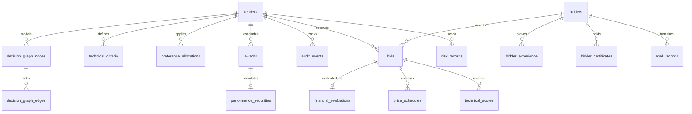

# TENDERLENS — Database Design Specification

---

## 1. Relational Design Principles
1. **Third Normal Form (3NF)**: Strict data normalization prevents anomaly states.
2. **Mandatory Foreign Key Enforcement**: Activated via `PRAGMA foreign_keys = ON;` on every database connection.
3. **Zero Floating-Point Storage**: All currency, percentage, and scoring values are stored as high-precision text strings (e.g., `"50000000.00"`), mapped to Python `decimal.Decimal` in memory. SQLite `REAL` and floating-point types are strictly forbidden.
4. **Cascade Deletes**: Child credential records, scorecards, price schedules, and decision nodes cascade-delete upon parent tender/bid removal.
5. **Auditing & Immutability**: Historical audit records and decision nodes are append-only.

---

## 2. Entity Relationship Overview

---

## 3. Detailed Table Schema Definitions

### 3.1 `tenders`
Core procurement tender registry.
- `tender_id` (TEXT, PK): Unique tender code (e.g., `TND001`).
- `title` (TEXT, NOT NULL): Official procurement title.
- `estimated_cost` (TEXT, NOT NULL): Estimated cost in INR decimal string.
- `bid_opening_date` (TEXT, NOT NULL): ISO date (`YYYY-MM-DD`).
- `bid_closing_date` (TEXT, NOT NULL): ISO date (`YYYY-MM-DD`).
- `bid_validity_days` (INTEGER, NOT NULL): Default 90 days.
- `evaluation_method` (TEXT, NOT NULL): `LCS` or `QCBS`.
- `qcbs_tech_weight` (TEXT): Default `"70.00"`.
- `qcbs_fin_weight` (TEXT): Default `"30.00"`.
- `emd_amount` (TEXT, NOT NULL): Calculated or configured EMD amount.
- `mse_relax_enabled` (INTEGER, NOT NULL): 1 if MSE relaxation permitted; 0 otherwise.
- `single_bid_allowed` (INTEGER, NOT NULL): 1 if single responsive bid award allowed.
- `is_reserved_item` (INTEGER, NOT NULL): 1 if reserved 100% for MSE.
- `status` (TEXT, NOT NULL): `PUBLISHED`, `EVALUATING`, `AWARDED`, `RETENDER_TRIGGERED`, etc.

### 3.2 `bidders`
Registered vendor profiles.
- `bidder_id` (TEXT, PK): Unique vendor code.
- `name` (TEXT, NOT NULL): Registered commercial entity name.
- `organization_type` (TEXT, NOT NULL): Private Limited, LLP, Partnership, PSU.
- `is_blacklisted` (INTEGER, NOT NULL): 1 if blacklisted; 0 otherwise.
- `blacklisted_since` (TEXT): Date from which blacklisting became effective.

### 3.3 `bids`
Bid submissions binding bidders to tenders with logical envelope separation.
- `bid_id` (TEXT, PK): Unique submission identifier.
- `tender_id` (TEXT, FK -> tenders.tender_id).
- `bidder_id` (TEXT, FK -> bidders.bidder_id).
- `technical_envelope_opened` (INTEGER, NOT NULL): Status of Envelope 1.
- `financial_envelope_opened` (INTEGER, NOT NULL): Strict Two-Envelope protection guard.
- `responsiveness_status` (TEXT): `SUBMITTED`, `RESPONSIVE`, `NON_RESPONSIVE`, `WITHDRAWN`.
- `technical_status` (TEXT): `PENDING`, `QUALIFIED`, `DISQUALIFIED`.
- `overall_technical_score` (TEXT): Weighted technical score out of 100.
- `financial_status` (TEXT): `LOCKED`, `OPENED`, `EVALUATED`, `REJECTED`.
- `final_rank` (INTEGER): Final competitive rank (1 for L1/H1).

### 3.4 `bidder_experience`
Past credentials for 7-year experience evaluation.
- `exp_id` (TEXT, PK)
- `bidder_id` (TEXT, FK)
- `contract_value` (TEXT, NOT NULL): Value in INR decimal string.
- `completion_date` (TEXT, NOT NULL): Completion date in ISO format.

### 3.5 `bidder_certificates`
Statutory compliance credentials.
- `cert_id` (TEXT, PK)
- `bidder_id` (TEXT, FK)
- `cert_type` (TEXT, NOT NULL): `MSE`, `STARTUP`, `MAKE_IN_INDIA`, `ISO`.
- `local_content_percentage` (TEXT): Local value addition percentage.
- `is_valid` (INTEGER, NOT NULL)

### 3.6 `emd_records`
Earnest money deposit tracking.
- `emd_id` (TEXT, PK)
- `tender_id` (TEXT, FK)
- `bidder_id` (TEXT, FK)
- `payment_mode` (TEXT): `BG`, `DD`, `ONLINE`, `EXEMPT`.
- `amount_paid` (TEXT): Deposited amount.
- `valid_until` (TEXT): Bank guarantee expiry date.
- `status` (TEXT): `PENDING`, `VALID`, `INVALID`, `FORFEITED`, `RELEASED`.

### 3.7 `technical_criteria` & `technical_scores`
- Normalized criteria breakdown with weight percentages (summing to 100%).
- Individual raw evaluator scores (0 to 100).

### 3.8 `price_schedules` & `financial_evaluations`
- Line-item price schedule items capturing quantity, quoted unit rate, and quoted total.
- Commercial evaluation tracking original quoted price, unit-rate arithmetic corrections, tax and freight adjustments, normalized comparative price, and abnormally low flags.

### 3.9 `preference_allocations`
- Captures statutory purchase preference apportionments (MSE 25%, Make-in-India 50%) and matched prices.

### 3.10 `awards` & `performance_securities`
- Formal contract award records, LoA references, 21-day security submission horizons, and tracking of standard (3%) vs abnormal (5% + additional) deposits.

### 3.11 `decisions`
- Comprehensive, rule-by-rule explainability records containing input snapshots, threshold values, mathematical steps, results (`PASS`/`FAIL`/`WARNING`/`BLOCKED`), and narrative explanations.

### 3.12 `decision_graph_nodes` & `decision_graph_edges`
- Persistent backing store for the computable DAG representing the 9 evaluation stages and dependency rules.

### 3.13 `audit_events`
- Chronological SHA-256 hash-linked audit chain recording immutable state transitions.

### 3.14 `simulations` & `risk_records`
- What-if scenario differentials and identified multi-category procurement vulnerabilities.
